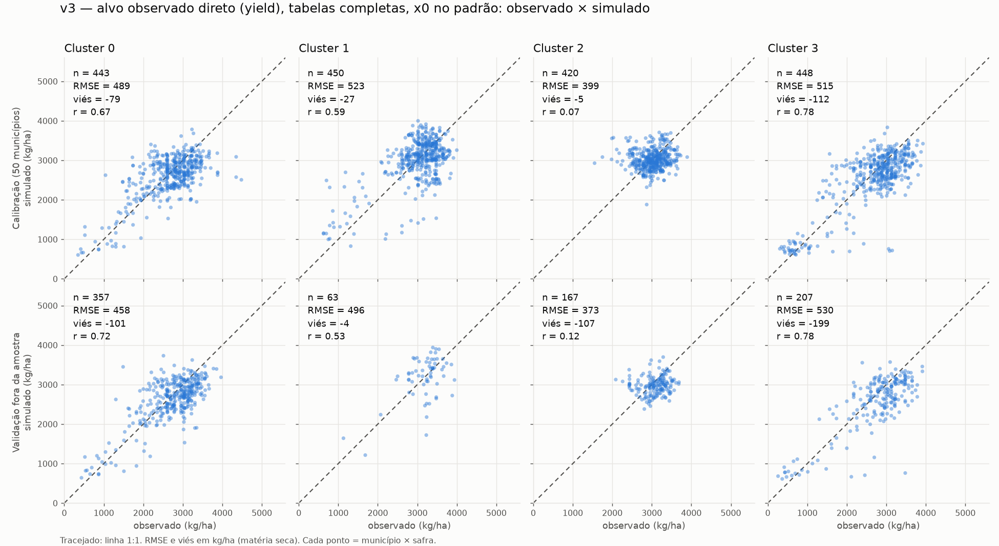
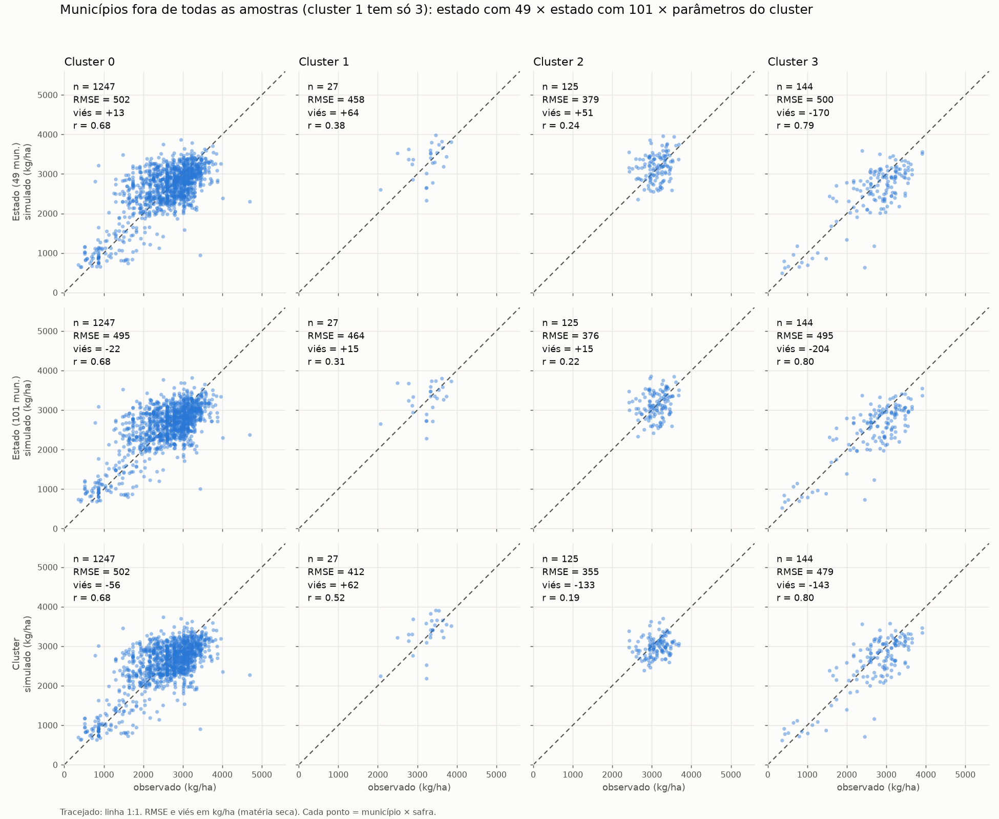

# Estouro de produtividade na calibração regional da soja (PR)

Registro da investigação na branch `test/soybean-yield-overflow`.
Todas as produtividades abaixo estão em **kg/ha, matéria seca** (observado IBGE × 0,87).
RMSE, viés e sd em kg/ha. "r" é a correlação de Pearson entre observado e simulado.

## 1. Problema

A calibração regional produzia produtividades simuladas de ~10⁶ kg/ha
(grupo 3: média 4,6×10⁶, `R² = 0` na validação), grupos "bons" só porque o
otimizador degenerava a lavoura, e um grupo salvo com parâmetros vazios e `rmse = Infinity`.

## 2. Causa raiz e hipóteses

| # | Hipótese | Resultado | Evidência |
|---|---|---|---|
| H1 | `TWSO * 1000` na simulação (herdado do milho) | **Confirmada** | `TWSO` do PCSE já é kg/ha. Simulação de referência (variedade padrão, solo `ec4`, clima real): `TWSO` ≈ 5000 kg/ha cru; com o ×1000, ~5×10⁶. IBGE/SIDRA 5457 var. 112 é **kg/ha** (metadados oficiais) |
| H2 | `FTOL_ABS = 0,1` (escala kg/ha) com objetivo em `log1p` | **Confirmada** | Modelo sintético com solução conhecida parava com 614 kg/ha de erro |
| H3 | `inf` e alvo não finito aceitos pela função objetivo | **Confirmada** | Testes falhavam antes da correção |
| H4 | Grupo totalmente falho salvo como válido | **Confirmada** | Grupo 3: `params.csv` vazio, `rmse = Infinity` |
| H5 | Dimensões mortas no BOBYQA | **Confirmada** | `fixed_params` sobrescreve `X` dos parâmetros já calibrados: mudar `X[TDWI]` de 50 para 200 não alterou o objetivo |
| H6 | Alvo ≤ 0 (artefato do detrending) → `log1p` = `NaN` | **Confirmada** | Cluster 3, safra 2022 do município 4108320: −40,6 kg/ha |
| H7 | Alvo sem tendência (`dyield`) em vez do observado direto | **Confirmada** | Série bruta `yield` está nos mesmos `.nc` e não tem valores ≤ 0 |
| H8 | Tabelas do WOFOST calibradas parcialmente substituem a tabela inteira | **Confirmada** | `AMAXTB` só com {0,82; 2,0} no valor padrão: TWSO médio −58% (5050 → 2144) |
| H9 | Teto de 120 dias trunca ciclos | **Parcial** | Com parâmetros padrão, 17% dos ciclos de amostra do estado ficavam com DVS < 2; no cluster 3 piloto 120 × 140 foi idêntico |
| H10 | Limite inferior de `SPAN` (17) aperta o ajuste | **Rejeitada** | Com mínimo 10, `SPAN` ficou em 16,4 e o ajuste não melhorou |
| H11 | Solo `ec4` | Não causa | O estouro ocorria com parâmetros padrão, independente do solo |

## 3. Correções (commits)

Cada uma com teste; suíte final: 45 testes.

1. `ec245ba` remove `× 1000` sobre `TWSO` (milho mantém o fator via `TWSO_TO_KG_HA`)
2. `da10c4b` `inf` e alvo não finito contam como falha
3. `df8a2bf` `FTOL_ABS` 0,1 → 1e-3 (escala `log1p` ≈ erro relativo)
4. `b7a85b4` calibração totalmente falha é sinalizada (`calibration_failed`), sem `Infinity`
5. `2d16d8f`, `55f8580`, `fbcd152` avaliação paralela (`n_workers`) e bypass do `gc.collect()` do PCSE
6. `ea897eb`, `4689e1f` `max_duration` com fonte única; padrão 140 dias
7. `3dd7ae7` só os parâmetros novos de cada etapa entram na busca
8. `ff150c2` descarta safras com alvo ≤ 0
9. `f3640bd` calibra contra a produtividade observada direta (`yield`)
10. `d631d1e` tabelas completas: tabela padrão + joelhos calibrados (só na classe da soja)
11. `d930fe6` ponto inicial dos parâmetros novos = valor padrão da variedade
12. `7e5237d`, `07c8854` notebook 7.1: `N_WORKERS`, saída versionada, tratamento de falha

## 4. Desempenho

- Custo medido: ~230 ms por simulação; ~24 s por avaliação em tamanho real (~450 amostras, 8 processos).
- Speedup medido: **4,0×** (4 processos) a **4,7×** (8), com resultado **idêntico** ao serial (teste de igualdade exata).
- Calibração dos 4 clusters: 3,0 h (antes do ajuste de dimensões mortas a estimativa era 20–28 h).

## 5. Resultados (v3: alvo observado direto, tabelas completas, x0 no padrão)

Validação em municípios **fora da amostra de calibração** (50 municípios sorteados por cluster, seed 42):

| Cluster | Municípios / pares | RMSE v3 (padrão) | Viés | r | RMSE/sd(obs) |
|---|---|---|---|---|---|
| 0 | 40 / 357 | 458 (2273) | −101 | 0,72 | 0,73 |
| 1 | 7 / 63 | 496 (2654) | −4 | 0,53 | 1,05 |
| 2 | 21 / 167 | 373 (2749) | −107 | 0,12 | 1,22 |
| 3 | 23 / 207 | 530 (1914) | −199 | 0,78 | 0,68 |



A v2 (alvo sem tendência, tabelas parciais) está em `output/soja_pr/Optimization/v2_kgha_140d/`
e em `img/v2_por_cluster.png`; é mantida só para registro, os alvos são séries diferentes
e os números não são diretamente comparáveis.

### Cluster 2 sem habilidade

- sd interanual dentro do município: 218 kg/ha (clusters 0, 1, 3: 565 a 725).
- r temporal: 0,08 (clusters 0, 1, 3: 0,64 a 0,82).
- Prever só a média do cluster dá RMSE de ~305; nenhum conjunto de parâmetros (nem o padrão) passa de r ≈ 0,2.
- Possíveis causas, **não verificadas**: variabilidade movida por manejo, suavização das estimativas municipais do IBGE, estresses não modelados (pragas, doenças, nutrientes).

### Estado × cluster

Um único conjunto para o estado (`v3_estado`, 49 municípios) e outro com 101 (`v3_estado100`), comparados com os por cluster em
municípios fora de **todas** as amostras (clusters 0, 1, 2, 3: 141, 3, 14 e 16 municípios):

| Cluster | RMSE estado49 / estado101 / cluster | r estado49 / estado101 / cluster |
|---|---|---|
| 0 | 502 / 495 / 502 | 0,68 / 0,68 / 0,68 |
| 1 (3 mun.) | 458 / 464 / 412 | 0,38 / 0,31 / 0,52 |
| 2 | 379 / 376 / 355 | 0,24 / 0,22 / 0,19 |
| 3 | 500 / 495 / 479 | 0,79 / 0,80 / 0,80 |
| todos | 492 / 486 / 488 | 0,70 / 0,70 / 0,70 |



Mais municípios (101 contra 49) não melhoraram; um conjunto único é equivalente aos por cluster nos clusters 0 e 3.

## 6. Limitações

- Validação de **um só sorteio**; holdout pequeno nos clusters 1 e 2 (3 a 21 municípios).
- Viés negativo em todos os clusters (−4 a −199): o modelo é potencial hídrico (sem pragas, doenças, nutrientes).
- Com o alvo bruto, a tendência de tecnologia entra no alvo e o modelo não a representa.
- `dyield` e `yield`: a comparação v2 × v3 mistura duas mudanças (alvo e tabelas).
- Notebooks 6, 7 e 8 **não** foram atualizados: 7 e 8 (por município) têm resultados calibrados com o erro do `× 1000`; o ranking do 6 (Morris) deve ser invariante à escala, mas não foi retestado.
- Resultados antigos em `output/soja_pr/Optimization/OPT_REGIONAL_group*` continuam no repositório e são **inválidos** (calibrados com o `× 1000`).

## 7. Reprodução

```bash
python -m pytest tests -q          # 45 testes (alguns usam os .nc reais)
```

Scripts usados (em `docs/experiments/scripts/`, caminhos da máquina de origem): `run_regional.py`
(executa as células do notebook 7.1 sem interface), `holdout_validation.py`,
`compare_estado_cluster.py`, `scatter_comparacao.py`.
Saídas versionadas em `output/soja_pr/Optimization/{v2_kgha_140d,v3_yield_tabelas,v3_estado,v3_estado100}/`.

## 8. Validação cruzada: plantio e número de parâmetros calibrados

Branch `exp/calibracao-soja-melhoria`. Um único modelo estadual (PR) calibrado em até 50 municípios
(proporcionais por cluster), avaliado fora da amostra, com as **mesmas partições e semente (42)** em
todas as rodadas, o que permite comparação pareada.

- **Espacial:** 5 partições de municípios (estratificadas por cluster); treina nos demais, testa nos da partição, todas as safras.
- **Temporal:** 3 blocos de safras (2016–18, 2019–21, 2022–24); treina nas outras safras, testa no bloco, nos mesmos municípios.
- **Métricas:** RMSE, viés, r e r temporal (anomalias dentro do município). IC 95% da diferença por bootstrap de municípios.
- Plantio em 1º de novembro, salvo indicação.

| Rodada | Parâmetros | Plantio | Espacial: RMSE / r temp. | Temporal: RMSE / r temp. |
|---|---|---|---|---|
| base | 44 | 1 nov | 512 / 0,68 | 601 / 0,28 |
| sow1015 | 44 | 15 out | 512 / 0,67 | 601 / 0,61 |
| p15 | 15 | 1 nov | 515 / 0,66 | 556 / 0,51 |
| p15_sow1015 | 15 | 15 out | 521 / 0,65 | 606 / 0,58 |
| p10 | 10 | 1 nov | 521 / 0,64 | 565 / 0,55 |
| p8 | 8 | 1 nov | 532 / 0,61 | 588 / 0,47 |

O modelo padrão da variedade, sem calibração, tem RMSE ≈ 2400 e r temporal 0,67–0,71 nos mesmos dados.

Resultados:

- **Menos parâmetros ajudam em safras não vistas.** Com 15 parâmetros, o r temporal da validação temporal sobe 0,23 (IC [0,18; 0,28]) e o RMSE cai 44 kg/ha (IC [−67; −19]) em relação a 44 parâmetros. Com 10, o ganho de r temporal é 0,27 e o RMSE não difere de forma significativa; 10 e 15 não se distinguem.
- **Custo espacial cresce com a redução.** RMSE espacial: 15 parâmetros +3 (n.s.), 10 parâmetros +9 (IC [+1; +17]), 8 parâmetros +20 (IC [+10; +29]). Com 8 parâmetros o ganho temporal também recua.
- **Plantio em 15 de outubro** eleva o r temporal da validação temporal, sem mudar o RMSE, e aumenta o viés negativo (cluster 3: −439 kg/ha com 15 parâmetros). Na validação espacial é neutro a levemente pior.
- **Cluster 2** segue sem habilidade temporal em todas as configurações (variabilidade interanual baixa).
- Com 44 parâmetros, o modelo calibrado tem r temporal menor em safras não vistas (0,28) que o padrão da variedade (0,68): indício de sobreajuste a poucos anos.

Limitações específicas:

- Só 3 blocos temporais, com peso grande da seca de 2022; o bootstrap reamostra municípios, não safras.
- Cada configuração foi rodada uma vez (variação entre sementes desconhecida); 15 parâmetros como ponto de equilíbrio é uma escolha, não um resultado testado (10 e 15 empatam no temporal).
- Os parâmetros vêm do ranking de Morris calculado com a escala ×1000; assume-se que a ordem não muda.
- Rodadas com 15 parâmetros e plantio em 15 de outubro e com 8/10 parâmetros foram feitas só em um plantio cada; não há 8/10 com 15 de outubro.

Reprodução (variáveis em `scripts/cross_validation.py`):

```bash
CV_TAG=p15 CV_N_PARAMS=15 CV_MODE=both python -X utf8 docs/experiments/scripts/cross_validation.py
CV_TAG=p15_sow1015 CV_N_PARAMS=15 SOJA_PR_SOWING_MONTH=10 SOJA_PR_SOWING_DAY=15 python -X utf8 docs/experiments/scripts/cross_validation.py
python docs/experiments/scripts/compare_cv.py base p15 docs/experiments/cv_comparacoes/base_vs_p15.json
```

Saídas em `output/soja_pr/Optimization/cv_<tag>/` (só resumos, partições, previsões e `metrics.json` por partição versionados) e comparações em `docs/experiments/cv_comparacoes/`.
